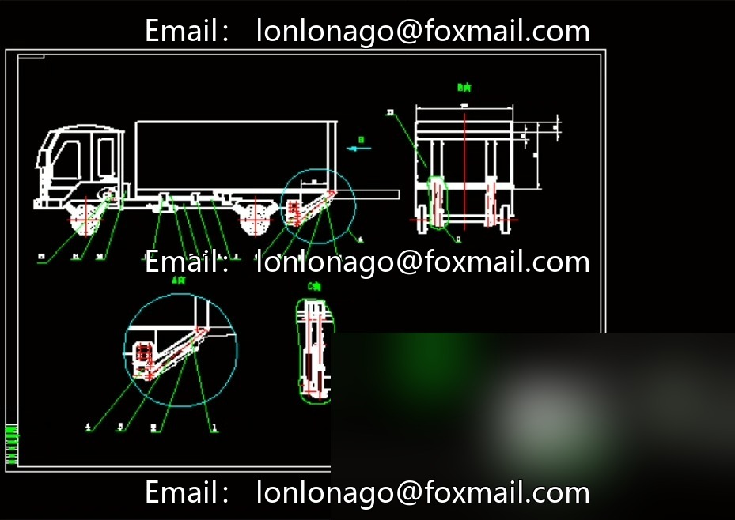
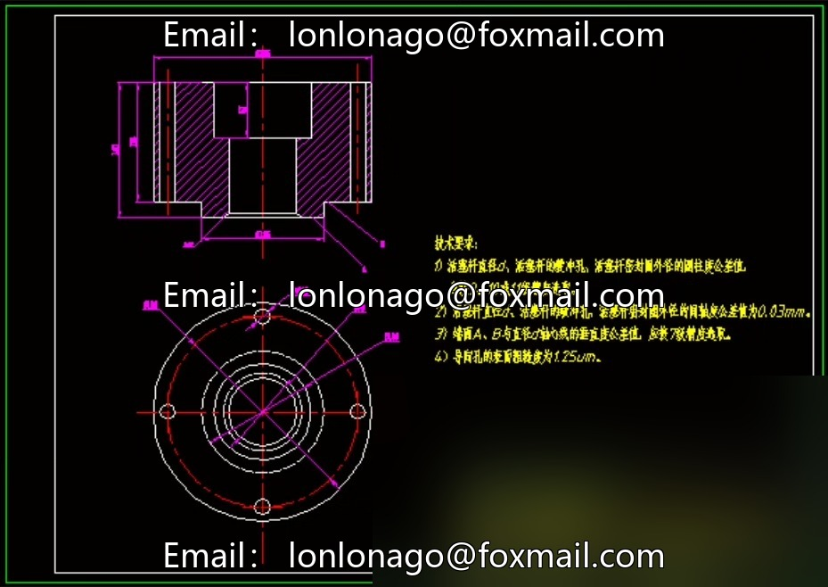
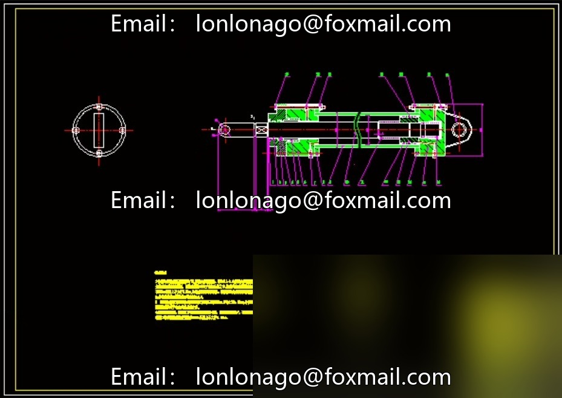
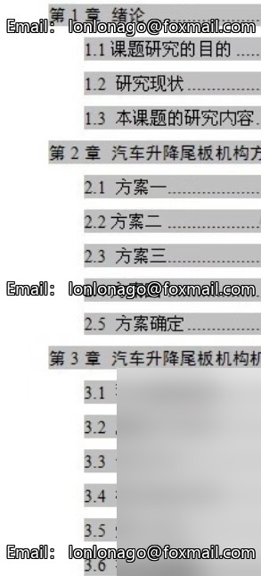
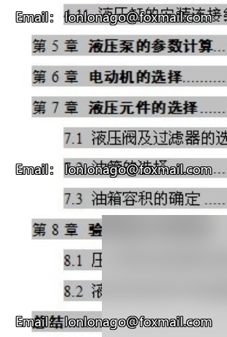

# Vehicle platform extension deck structure design, vehicle platform extension deck design, vehicle platform extension deck diagram, car platform extension deck

## Body

The structure design of the car lift tail cover; car lift tail cover design; car lift tail cover drawing; car lift tail cover design CAD drawing

139 The design introduces methods for solving optimal design and engineering design problems for plane link mechanisms. Based on the general process of analyzing the deceleration force of the vehicle's lifting rear deck, In general, the mathematical model for simulating the main factors in vivo should be clarified during design. Provided with reliable foundation The model establishes an institution that has authority to determine the objective function. To determine the optimized programming program for operation. The constraint during vehicle loading and unloading is the optimized design result of a complete hydraulic elevation and adjustment regulator. To prove the reliability of this testing platform. The comparison analysis between the values calculated through experiments and the actual measurement values confirms that. The calculation value is obtained reliably. Results obtained through optimizing some parameters and considering factors influencing the hydraulic control system with actuators present simultaneously, Given

Adjustment and improvement of the execution mechanism shall be determined.

The design covers the structure design of a car lift tail panel, the plane link mechanism optimization method, hydraulic adjustment optimization and multiple hydraulic system drawings and calculations.

<!-- AI_ENRICHED -->

## Images

## Payment

Here is a pay link on Stripe ( https://buy.stripe.com/3cs8yP7sY87d0vu9AB ). Please contact me lonlonago@foxmail.com after funding $89, and I will send you a complete data files , thank you!

